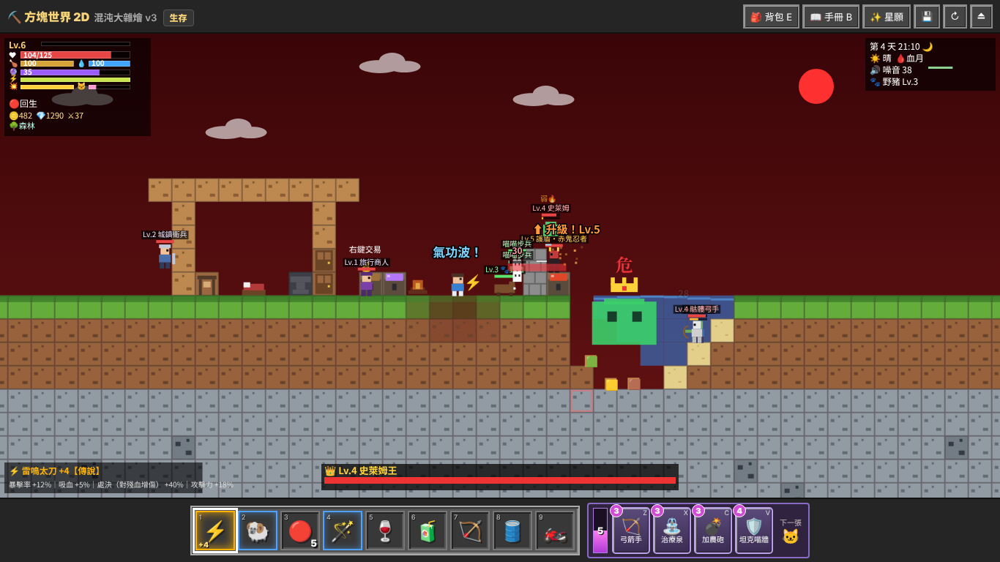

# mcwork — 方塊世界 2D：混沌大雜燴 v3

一個 2D 方塊沙盒網頁遊戲（單一 `index.html`），從 Minecraft 風格的挖礦合成出發，混入泰拉瑞亞、殭屍毀滅工程、崩壞：星穹鐵道、原神、GTA、皇室戰爭、貓咪大戰爭、隻狼、荒野亂鬥、PUBG、快打旋風、寶可夢的招牌機制。

- 線上遊玩：https://shadowc113156211.github.io/mcwork/
- 完整規格書：`第11週補交_繳交內容.md`
- 舊版（v2）備份：`old_v2_index.html`

## 主要系統
- 生存數值：生命、飽食、口渴、魔力、體力、架勢、流血／中毒／燃燒、回生
- 武器稀有度＋隨機詞條、鐵砧強化／重鑄／升階
- 火冰雷元素反應（融化／超載／超導）、弱點與架勢崩潰、忍殺、彈反
- 怪物會升級、精英詞綴、Boss 史萊姆王、血月、屍潮、雷雨、空投
- 防禦塔、木門、尖刺、爆破桶、攻城槌、越野機車
- 聖水卡牌召喚（12 張卡）、星願抽卡（保底）、收服寵物
- 通緝系統、商人交易、噪音系統、模擬宇宙祝福、成就與圖鑑

按 **B** 打開遊戲內「冒險手冊」查看全部操作。
