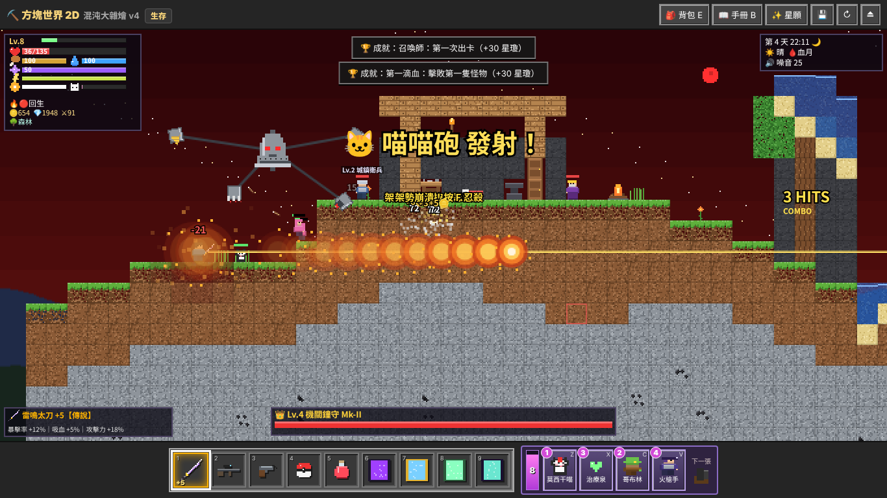
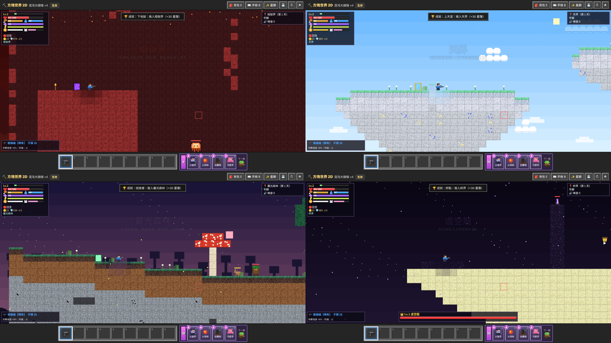

# mcwork — 方塊世界 2D：混沌大雜燴 v4

單一 `index.html` 的 2D 像素風方塊沙盒遊戲：從 Minecraft 式的挖礦合成出發，加入五個維度（主世界、熔獄界、天界、暮光森林、終界）、13 隻招式各異的原創 Boss、散落的寶箱建築與槍械、更聰明的 AI、38 張卡牌，以及元素反應、武器詞條、抽卡、寵物、通緝等系統。

- 線上遊玩：https://shadowc113156211.github.io/mcwork/
- 完整規格書：`第11週補交_繳交內容.md`
- 舊版備份：`old_v2_index.html`、`old_v3_index.html`

進入遊戲後按 **B** 開啟「冒險手冊」查看操作、維度、Boss 與卡牌。所有角色與名稱皆為原創像素畫，只借用各遊戲的玩法概念。
